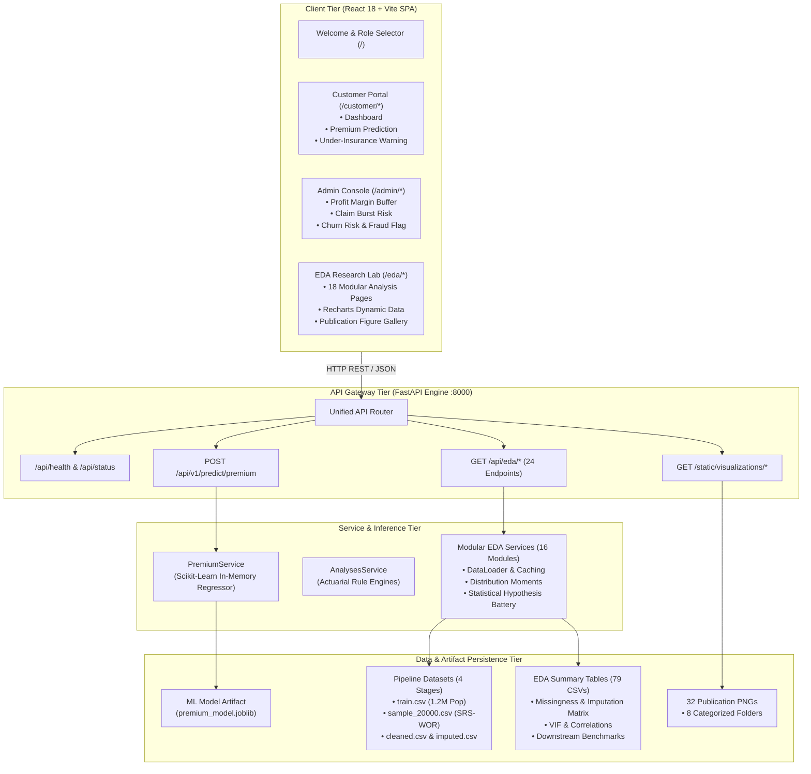
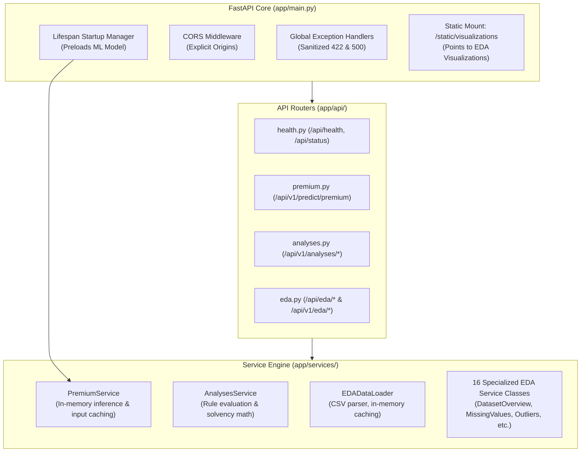

# Insurance Intelligence — Final System Architecture

This document specifies the complete, production-grade technical architecture of the **Insurance Intelligence** full-stack actuarial and machine learning platform.

---

## 1. System Topology & Data Flow



---

## 2. Frontend Architecture (React 18 + TypeScript + Vite)

### 2.1 Component Hierarchy & Routing
The frontend is structured into three distinct domain experiences sharing a unified design token system:

1. **Public Zone:**
   - `WelcomePage.tsx` — Landing page highlighting dual-role onboarding and EDA research overview.
   - `pages/auth/` — Role-based customer login, customer signup, and administrator authentication.
2. **Customer Experience (`layouts/CustomerLayout.tsx`):**
   - `CustomerDashboard.tsx` — Policy overview, quick quota simulator, recent risk assessment.
   - `PremiumPredictionPage.tsx` — Input parameters, validation, live inference call, risk tier categorization.
   - `UnderInsurancePage.tsx` — Rule-based dependent coverage adequacy audit.
3. **Administrator Experience (`layouts/AdminLayout.tsx`):**
   - `AdminDashboard.tsx` — Executive portfolio health, claims distribution, churn metrics.
   - `UnderwritingMarginPage.tsx` — Solvency buffer analysis against claim volatility.
   - `ClaimBurstRiskPage.tsx` — Geospatial and accident frequency clustering.
   - `CustomerChurnPage.tsx` — Premium rate-shock sensitivity profiler.
   - `FraudAuditPage.tsx` — Synthetic generation and credit-to-income anomaly flags.
4. **EDA Research Lab (`layouts/EdaLayout.tsx`):**
   - 18 dedicated analysis modules organized across 5 analytical groups (Foundation, Integrity & Preprocessing, Distributions & Relationships, Inference & Modeling, Synthesis & Visualizations).
   - `VisualizationsGalleryPage.tsx` — High-resolution artifact gallery with full-screen inspection modal.

### 2.2 Reusable EDA Component Library
All 18 EDA pages are composed using modular, reusable components located in `frontend/src/components/eda/`:

- **`EdaSectionHeader`**: Standardized page headers displaying dimension numbers, descriptive subtitles, badges, and action toolbars.
- **`EdaCard`**: Polished container cards with customizable badge variants (`teal`, `blue`, `emerald`, `amber`, `rose`, `purple`, `indigo`).
- **`EdaMetricCard`**: High-impact KPI display cards with accent colors, icons, subtitles, and percentage deltas.
- **`EdaDataTable`**: Generic sortable, searchable, paginated data table component supporting custom cell renderers.
- **`EdaFigureCard`**: High-resolution image card with thumbnail preview, loading skeletons, broken-image handling, and click-to-modal triggers.
- **`EdaFigureModal`**: Full-screen modal overlay supporting keyboard escape navigation, direct download, and external tab opening.
- **`EdaLoading` & `EdaError`**: Uniform async loading spinners and error banners with integrated retry callbacks.

### 2.3 Optimization & Bundle Architecture
The frontend employs aggressive route-based code splitting and Rollup vendor chunking in `vite.config.ts`:

- **Dynamic Route Splitting:** All 18 EDA pages are imported via `React.lazy()` and wrapped in `React.Suspense` within `EdaLayout`.
- **Manual Vendor Chunking:**
  - `vendor-charts`: Recharts charting library (~412 kB).
  - `vendor-react`: React, React-DOM, React-Router-DOM (~162 kB).
  - `vendor-icons`: Lucide React icon package (~30 kB).
  - `index`: Core application bundle (~177 kB, 38.5 kB gzip).
  - **Individual EDA Pages:** Isolated chunks between 5.4 kB and 9.2 kB loaded strictly on-demand.

---

## 3. Backend Architecture (Python 3.11 + FastAPI)



### 3.1 Application Entry & Lifecycle (`app/main.py`)
- **Startup:** The `lifespan` async context manager initializes logging and preloads the Scikit-Learn regression pipeline into RAM via `PremiumService.load_model()`.
- **Static Mounting:** Mounts `settings.EDA_VISUALIZATIONS_DIR` at `/static/visualizations` with non-blocking async file streaming.
- **Exception Sanitization:** Custom handlers for `RequestValidationError` (HTTP 422 with structured field error lists) and generic unhandled exceptions (HTTP 500 with internal error logging and sanitized client responses).

### 3.2 Modular EDA Service Layer
To maintain high maintainability and prevent monolithic controllers, the EDA logic is partitioned into 16 distinct service modules in `app/services/eda/`:

1. `data_loader.py`: Centralized singleton reading CSV summary tables, converting numeric columns, and caching parsed dictionaries.
2. `dataset_overview.py`: Population vs sample metadata and 4 pipeline stages.
3. `data_quality.py`: Row-level completeness (67.68%), duplicate counts, and synthetic signatures.
4. `sampling.py`: SRS-WOR 20k sample validation, Kolmogorov-Smirnov tests, and categorical goodness-of-fit.
5. `missing_values.py`: Column-wise missingness, combinations, Little's MCAR omnibus test, and listwise hazard.
6. `imputation.py`: Decision matrix, 19,910 cell audit summary, and 5-fold CV imputation benchmarks.
7. `outliers.py`: Tukey IQR, Z-Score, and MAD multi-method tables with treatment comparisons.
8. `univariate.py`: Parametric moments, 15-bin histograms, and frequency profiles for 19 attributes.
9. `bivariate.py`: Predictor-to-target conditioning across numerical and categorical features.
10. `correlation.py`: 9x9 Pearson and Spearman correlation matrices with p-values and target rankings.
11. `multivariate.py`: Compound interaction risk slices and Variance Inflation Factor (VIF) evaluation.
12. `temporal.py`: longitudinal policy volume, monthly pricing drift (< 1.5%), and 100% fixed timestamp artifact (`15:21:39`).
13. `hypothesis_testing.py`: 11 formal statistical tests under Benjamini-Hochberg FDR correction.
14. `target_analysis.py`: Continuous Premium Amount moments, percentiles, and log/sqrt transformation metrics.
15. `feature_engineering.py`: Definitions and 5-fold CV ablation benchmarks for engineered features.
16. `model_diagnostics.py`: Comparative benchmark across 6 regression architectures.
17. `insights.py`: Consolidated executive findings and 18-point coverage matrix.

---

## 4. Machine Learning & Prediction Architecture

### 4.1 Production Regressor vs Historical EDA Benchmarks
A critical architectural boundary is maintained between the live production model and the exploratory EDA benchmarks:

```text
┌────────────────────────────────────────────────────────────────────────┐
│                   PRODUCTION INFERENCE PIPELINE                        │
│                   Route: POST /api/v1/predict/premium                  │
│                                                                        │
│  Validated Inputs (17 Features)                                        │
│          │                                                             │
│          ▼                                                             │
│  Scikit-Learn Pipeline (premium_model.joblib)                          │
│  ├── Median / Mode Preprocessor (Robust to Unseen Categories)          │
│  └── Trained Regression Estimator                                      │
│          │                                                             │
│          ▼                                                             │
│  Output: Estimated Premium ($) + Risk Tier + Inputs Echo               │
│  (Flag: isDemoResult = false)                                          │
└──────────────────────────────────┬─────────────────────────────────────┘
                                   │ STRICT ARCHITECTURAL BOUNDARY
┌──────────────────────────────────┴─────────────────────────────────────┐
│                   HISTORICAL EDA DIAGNOSTIC BENCHMARKS                 │
│                   Route: GET /api/eda/model-diagnostics                │
│                                                                        │
│  • Diagnostic comparison of 6 alternative architectures (MICE,         │
│    KNN, Median, DropNA, HistGradientBoosting, Missing Indicators).     │
│  • Used exclusively for academic documentation and actuarial research. │
│  • Does NOT handle live consumer premium predictions.                  │
└────────────────────────────────────────────────────────────────────────┘
```

### 4.2 Pydantic Validation & Schema Guards (`app/schemas/premium.py`)
All live prediction requests are validated through `PremiumPredictionInput`:
- `age`: Integer constrained to $18 \le \text{age} \le 100$.
- `annualIncome`: Float constrained to $\ge 0.0$.
- `healthScore`: Float constrained to $0.0 \le \text{score} \le 100.0$.
- `creditScore`: Integer constrained to $300 \le \text{score} \le 850$.
- `previousClaims`: Integer constrained to $0 \le \text{claims} \le 50$.
- Categorical features (`gender`, `maritalStatus`, `policyType`, etc.): Strictly constrained to enumerated Python Literals.

---

## 5. Security & Isolation Architecture

1. **Static Mount Whitelisting:**
   Only the publication figures directory (`EDA_Project_Final/visualizations/`) is mounted for static web serving. The raw population dataset (`train.csv`), raw sample files, and internal scripts are completely inaccessible via HTTP.
2. **CORS Whitelisting:**
   Cross-Origin Resource Sharing is restricted to explicit frontend origins (`localhost:5173`, `127.0.0.1:5173`) in development, with easily configurable domains in `backend/.env`.
3. **No Secret Leakage:**
   Environment variables are managed through Pydantic `BaseSettings`. No database credentials, API keys, or absolute host file system paths are exposed in frontend client bundles.
4. **Error Sanitization:**
   Backend internal stack traces are logged server-side and never returned in API responses to clients.
