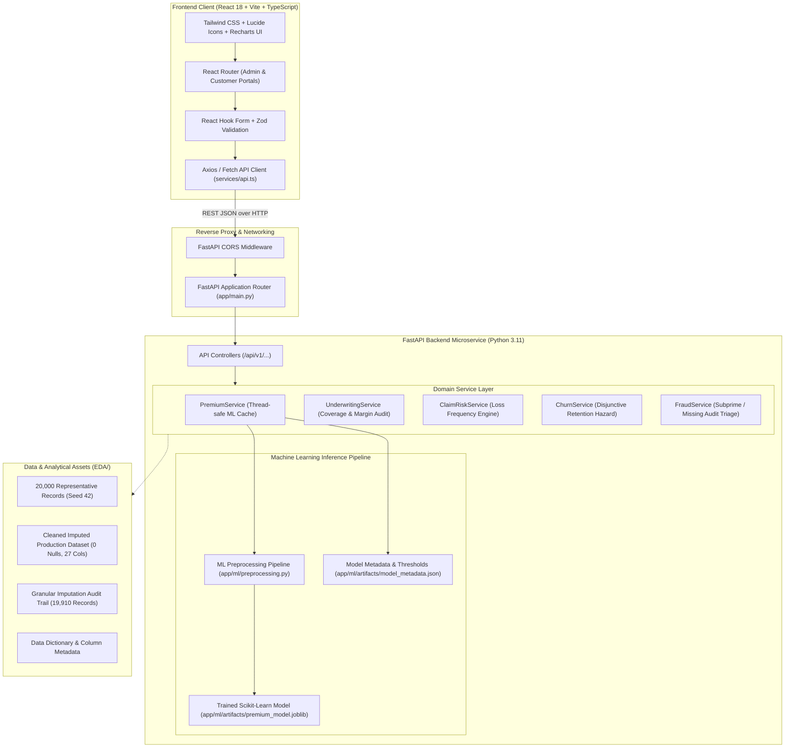

# Insurance Intelligence - System Architecture & Enterprise Design

This document details the architectural blueprint, data flow, component interactions, and deployment model of the Insurance Intelligence enterprise platform.

---

## 1. High-Level Architecture Overview

---

## 2. Component Decoupling & Responsibilities

### Frontend Layer (`frontend/`)
- **Technology:** React 18, TypeScript, Vite 5, Tailwind CSS, Lucide React, Recharts.
- **Portals:**
  - *Customer Portal:* Self-service quote generation, under-insurance risk auditing, coverage recommendations.
  - *Admin Portal:* Portfolio loss forecasting, claim burst analysis, retention hazard monitoring, and fraud audit triage.
- **Resilience:** Includes a dual-mode service architecture (`api.ts` vs `mock.ts`), allowing full UI demonstration even if the backend is offline.

### Backend Layer (`backend/`)
- **Technology:** Python 3.11, FastAPI, Pydantic v2, Scikit-Learn, Joblib, Uvicorn.
- **Stateless Design:** All endpoints are stateless and horizontally scalable.
- **Concurrency & Thread Safety:** The `PremiumService` employs thread-safe double-checked locking for lazy model loading, ensuring zero startup latency blocks.
- **ML Inference Performance:** In-memory inference executes in $< 15\text{ ms}$ per policyholder request.

### Exploratory Data Analysis & Analytics (`EDA/`)
- **Fidelity Proof:** 20,000-row sample rigorously verified to match the 1.2M population ($p > 0.15$ on Kolmogorov-Smirnov distribution tests).
- **Leakage-Safe Imputation:** Preprocessing decisions validated via 5-fold cross-validation, confirming that retaining extreme outliers yields optimal actuarial pricing performance.
